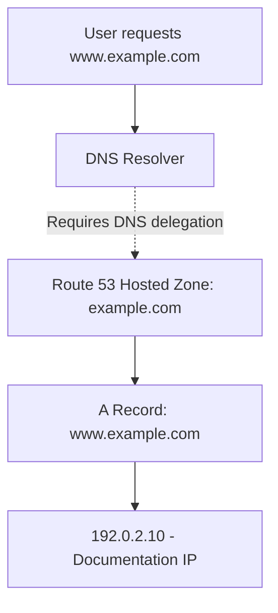
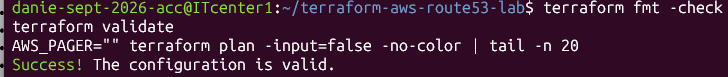

# Amazon Route 53 DNS Lab — Terraform

## Project Overview

This project demonstrates how to design Amazon Route 53 DNS
infrastructure using Terraform, AWS CLI, Ubuntu Linux, and Git.

**Deployment status: PLANNED ONLY — NOT DEPLOYED**

## Architecture



## Planned AWS Resources

| Resource | Count |
|---|---:|
| Public Route 53 hosted zone | 1 |
| DNS A record | 1 |
| **Total** | **2** |

## DNS Configuration

- Hosted zone: example.com
- Record: www.example.com
- Record type: A
- IPv4 address: 192.0.2.10
- TTL: 300 seconds
- AWS provider region: us-east-1

The domain and IPv4 address are reserved for documentation.

Route 53 is a global DNS service. The AWS provider region
does not make the public hosted zone regional.

## Tools

- Ubuntu Linux (WSL2)
- AWS CLI
- Terraform
- Git and GitHub

## Validation

Commands:

```bash
terraform fmt -check
terraform validate
terraform plan -input=false -no-color
```

Validated Terraform result:

**Plan: 2 to add, 0 to change, 0 to destroy.**

See [Validation Evidence](docs/validation-evidence.md).

## Deployment Status

No Terraform apply has been executed for this lab.

No public hosted zone or DNS record has been created.

The example.com domain is not controlled by this project.
A working public DNS setup would require ownership and
proper delegation of a real domain.

## Security and Cost

- Do not commit AWS credentials or Terraform state files.
- Do not run terraform apply without reviewing costs.
- Public hosted zones can incur monthly charges.
- Domain registration is a separate, potentially billable action.

## Future Improvements

- Configure a real domain owned by the operator.
- Add CNAME and alias records.
- Integrate Route 53 with CloudFront.
- Explore DNS health checks and routing policies.

## Actual Terraform Validation Screenshot


