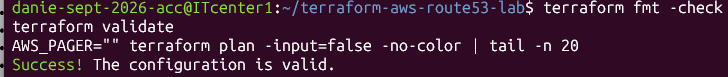

# Amazon Route 53 Terraform Validation Evidence

## Status

PLANNED ONLY — NOT DEPLOYED

## Environment

- AWS provider region: us-east-1
- Ubuntu Linux (WSL2)
- Terraform v1.17.0
- AWS CLI
- Git/GitHub

## Validated Results

Terraform validation:

Success! The configuration is valid.

Terraform plan:

Plan: 2 to add, 0 to change, 0 to destroy.

## Planned Resources

1. Route 53 public hosted zone: example.com
2. DNS A record: www.example.com -> 192.0.2.10

TTL: 300 seconds.

## Deployment Evidence

No terraform apply executed.

No AWS Route 53 resources deployed.

## Screenshot

The screenshot must contain actual terminal validation results.
